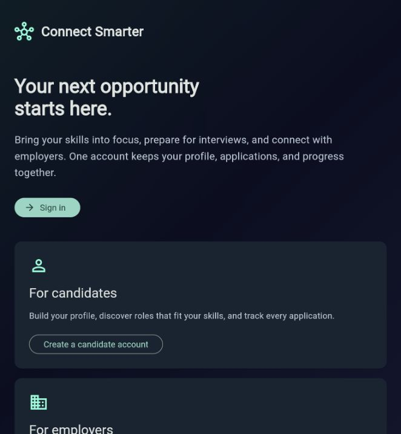

# Connect Smarter

Connect Smarter brings candidate profiles, CV skill analysis, interview preparation and employer application review into one Flutter application. Firebase Authentication and Firestore store accounts and structured data; a local FastAPI service extracts skills from uploaded CVs.

Arabic setup: [Start here](docs/START_HERE_AR.md).

Source repository: [Ahmedmazloumx1/connect-smarter](https://github.com/Ahmedmazloumx1/connect-smarter).



## Quick start on Windows

Install Flutter 3.44.1 / Dart 3.12.1, Python 3.12 and Git for Windows. Add Git and Flutter to PATH, then clone the source and open the project folder in PowerShell:

```powershell
git clone https://github.com/Ahmedmazloumx1/connect-smarter.git
cd connect-smarter
py -3.12 -m venv .venv
.\.venv\Scripts\python.exe -m pip install -r requirements.txt
powershell -ExecutionPolicy Bypass -File scripts\build-live-web.ps1
```

Start the local web application and CV service:

```powershell
powershell -ExecutionPolicy Bypass -File scripts\start-preview.ps1
```

Open **http://localhost:3000/**. If the services are already running, open the URL directly. Reload after rebuilding to load the new version. If the older `127.0.0.1` address shows a cached interface, use this localhost address. The CV service uses port 8000. Firebase operations require an internet connection.

Choose **Sign in**, **Create a candidate account**, or **Create a company account**. Use your own account. There are no shared sample accounts or guest entry points in the application.

## Available workflows

- Candidates: create a profile, analyze a PDF/DOCX/TXT CV, browse published jobs, review required-skill coverage and submit applications with explicit sharing consent.
- Employers: publish positions, manage their listings, review applicants and update application status.
- Interview preparation: five written questions, timed answers, reference-concept coverage and private saved results.
- Account settings: edit profile details, request password reset, sign out or delete the account and associated application data.
- Privacy policy and terms are available before signing in. Email actions open a draft in the user's mail application.

CV extraction reports skills present in the document. Interview feedback measures reference-concept mentions; it does not use an LLM or decide hiring eligibility. Original CV files are processed without being retained by the application.

## Firebase and existing data

The default connection is **`connect-smarter-ahmed-2026`**, with reviewed Firestore access rules. The original 26 documents and eight Authentication accounts were migrated with their UIDs and password hashes preserved. Temporary verification accounts and their records have been removed. Legacy listings without an owner are preserved in the database but excluded from the job browser; employers should publish valid listings through their own accounts. See [migration evidence](docs/FIREBASE_MIGRATION.md).

The application runs locally; publishing its source does not deploy the frontend or API. Android/iOS SDK configurations are included; native builds and device behavior have not been verified.

## Local checks

Latest local validation: analyzer passed, **19 Flutter tests**, **17 Python tests**, **10 Firestore rule tests**, and a release web build. The detailed [verification record](docs/VALIDATION.md) distinguishes current checks from historical migration checks.

The GitHub Actions workflow repeats Flutter analysis/tests/build, Python tests and isolated Firestore rule tests on pushes and pull requests. To run backend tests locally:

```powershell
.\.venv\Scripts\python.exe -m pip install -r requirements-dev.txt
.\.venv\Scripts\python.exe -m pytest backend/tests -q
```

The scripts use installed tooling or the existing bundled runtimes on the original PC. They do not install Git, Flutter or Python. The ZIP contains source, configuration, tests and documentation; dependencies and generated builds are excluded.

## Configuration

| Setting | Purpose |
| --- | --- |
| `--dart-define=API_BASE_URL=http://127.0.0.1:8000` | CV API address; Android emulator defaults to `10.0.2.2` |
| `ALLOWED_ORIGINS` (Python environment) | Comma-separated origins allowed by CORS |
| `--dart-define=FIREBASE_EMULATORS=true` | Explicit opt-in to isolated local development services |
| `--dart-define=FIREBASE_EMULATOR_HOST=127.0.0.1` | Local emulator host override |

Default web origins are `http://localhost:3000` and `http://127.0.0.1:3000`. Public API operation requires a separate deployment with authenticated access, rate limits, HTTPS and document-processing isolation. On a physical phone, localhost refers to the phone, so configure a reachable API address first.

## Development and validation

The build script formats Dart, runs analysis and Flutter tests, and builds a release web application using the live Firebase configuration. Completion is recorded in `build/live-verification.txt`; command output is saved to `build-live-web.log`.

See [development commands](docs/DEVELOPMENT.md) for Python checks and isolated Firebase rule tests, [validation record](docs/VALIDATION.md) for results, and [architecture](docs/ARCHITECTURE.md) for data boundaries. Test fixtures remain confined to development tooling and are not included in normal application data.

```text
lib/                 Flutter screens and entry point
lib/models/          CV analysis model
lib/services/        Auth, jobs, applications, CV networking and practice scoring
backend/             Stateless CV extraction API and skill bank
backend/tests/       Upload and API regression tests
test/                Flutter domain and widget tests
rules-tests/         Isolated Firestore security tests
scripts/             Build, local startup and verification commands
docs/                Setup, architecture, migration and verification evidence
```

Firebase client configuration is included; account exports, private keys, OAuth tokens and migration backups are not. Historical source changes are recorded in [SOURCE_CHANGES.md](docs/SOURCE_CHANGES.md). CV wording and the reusable refinement prompt are in `docs/PORTFOLIO.md` and `docs/REFINEMENT_PROMPT.md`.
